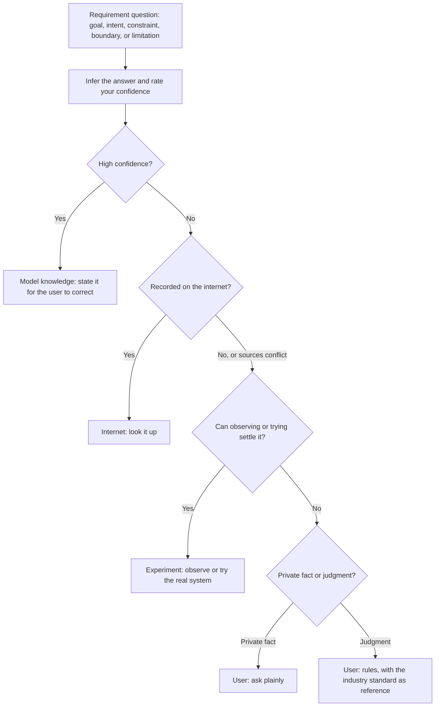

# Explore

## Goal

Expore the implementation details of the user's ideas by discussing the requirements from a top-down perspective (focus on goals, intents, constraints, boundaries, and limitations), unless the user explicitly initiates a bottom-up technical dive.

## How to Explore

1. **Model knowledge** is what you infer from the request, the context, and what you already know.
2. **Internet** covers what is publicly recorded, such as documentation, release notes, and industry practice.
3. **Experiment** covers what only observation or trial reveals. Reading this repository and running commands on this machine count as observation.
4. **User** answers what none of the three sources can settle: a private fact, such as a deadline, or a judgment, such as taste, priority, or risk tolerance.

**MUST:**

1. You **MUST** always clarify requirements from a top-down perspective (focusing on goals, intents, constraints, boundaries, and limitations) while autonomously inferring low-level implementation details, unless the user explicitly initiates a bottom-up technical dive.
2. You **MUST** state every inferred requirement with its source, and with your confidence and its reason when it comes from model knowledge, so the user can correct it.
3. You **MUST** bring a judgment to the user with the industry standard or best practice and its source, the tradeoffs, and your recommendation. When no industry standard exists, say so.
4. You **MUST** use the `experiment` skill to run every experiment against the real system.

**MUST NOT:**

1. You **MUST NOT** rate your confidence high about the system within reach, such as this repository or an installed tool, before you have observed it.
2. You **MUST NOT** ask the user anything that model knowledge, the internet, or an experiment can answer.
3. You **MUST NOT** present an industry standard as the user's ruling.
4. You **MUST NOT** keep asking once the answers stop changing the decision.

## Presenting

End the discussion with the clarified requirements, each labeled with its source; the recommendation and its rationale; and anything still open or assumed.

Present with the `/presentation` skill.
